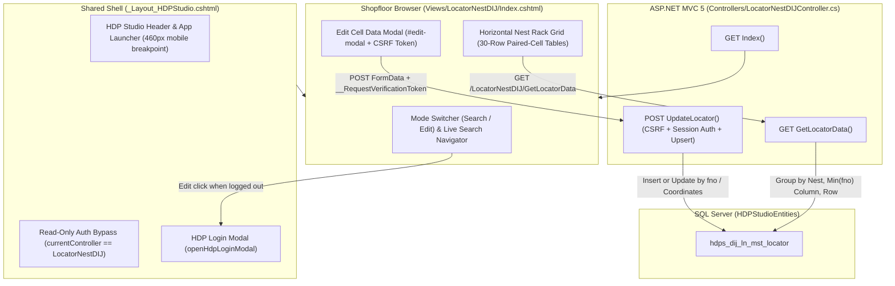
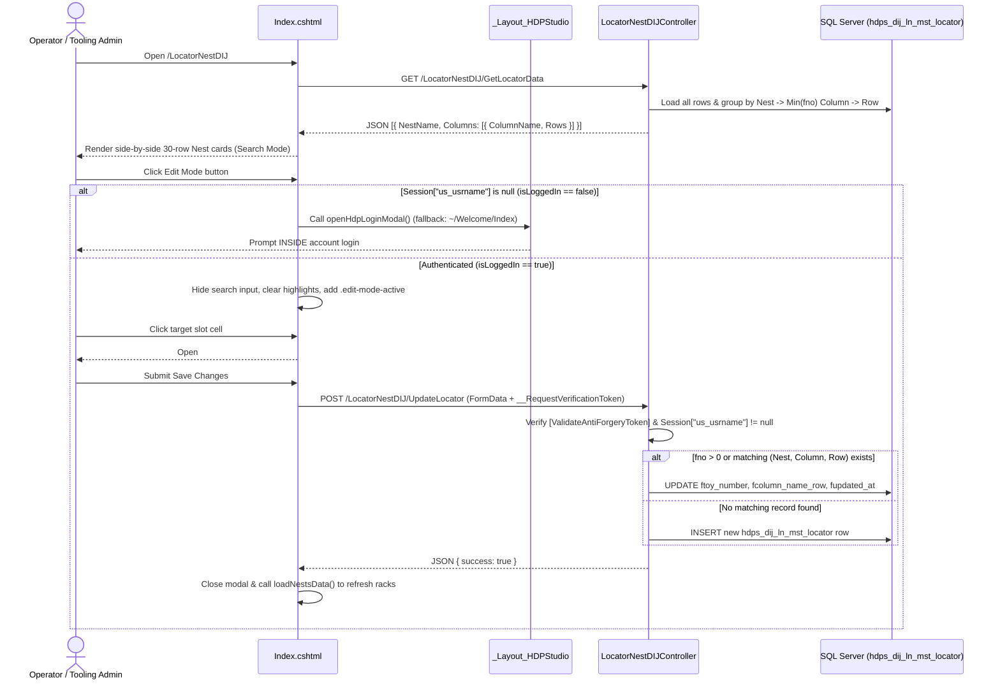
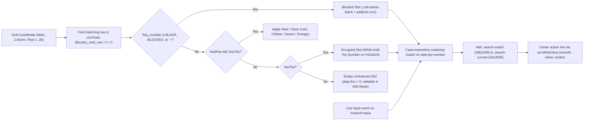

# HDP Locator Nest DIJ — System Architecture

**HDP Locator Nest DIJ** uses a lightweight single-controller, single-context ASP.NET MVC 5 architecture paired with client-side dynamic matrix rendering. All persistence reads and writes target a single Entity Framework 6 table (`hdps_dij_ln_mst_locator`) inside `HDPStudioEntities`.

## 1. High-Level Component Architecture

### Architectural Layer Responsibilities

| Layer | Responsibility | Key Files / Symbols |
| :--- | :--- | :--- |
| **Shared Shell & Auth** | Provides HDP Studio header (`HDP Locator Nest DIJ`), skips login wall for read-only shopfloor viewing, supplies `openHdpLoginModal()` for Edit Mode | `Views/Shared/_Layout_HDPStudio.cshtml` |
| **Client UI & Search** | Renders horizontally scrollable Nest cards, classifies cell zone colors and blocked states, runs live substring search and smooth scroll navigation, manages Edit Mode modal | `Views/LocatorNestDIJ/Index.cshtml` |
| **Controller API** | Serves the Razor view, groups flat rows into nested JSON (`Nest -> Column -> Rows`), enforces session auth and anti-forgery token validation on upsert writes | `Controllers/LocatorNestDIJController.cs` |
| **Persistence (`HDPStudioEntities`)** | Single master table storing Nest, Column, Row coordinates, Row sub-index, Toy Number, and timestamps | `Models/hdps_dij_ln_mst_locator.cs` (`hdps_dij_ln_mst_locator`) |

## 2. Grid Load & Authenticated Upsert Transaction Sequence

On page load, `Index.cshtml` fetches the complete grouped locator structure asynchronously. Mutations require an authenticated INSIDE session (`Session["us_usrname"]`) and a valid anti-forgery token, followed by a full grid reload to guarantee UI consistency with SQL Server.

## 3. Cell Rendering, Zone Color & Live Search Pipeline

Every rack renders a fixed `1..30` row grid across its columns. Each cell pair evaluates its visual class first during HTML generation, then participates in real-time substring search whenever Search Mode is active.

## 4. Security, Hygiene & Operational Observations

The following architectural strengths and future improvement opportunities were verified directly from `LocatorNestDIJController.cs` and `Views/LocatorNestDIJ/Index.cshtml`:

### Verified Strengths
- **CSRF Protection (CWE-352):** `UpdateLocator` is decorated with `[HttpPost]` and `[ValidateAntiForgeryToken]`, and `#edit-cell-form` renders `@Html.AntiForgeryToken()` and appends `__RequestVerificationToken` to the submitted `FormData`.
- **Server-Side Authorization Enforcement:** Even though `_Layout_HDPStudio.cshtml` bypasses login for read-only shopfloor viewing, `UpdateLocator` independently enforces `Session["us_usrname"] != null` before any database write (preventing unauthorized direct POST calls).
- **Parameterized Queries Only (CWE-89):** Both `GetLocatorData` and `UpdateLocator` use strongly typed Entity Framework 6 LINQ queries with zero raw SQL string concatenation.

### Operational & Hardening Considerations

> [!WARNING]
> **Frontend `innerHTML` Escaping (`loadNestsData`):** In `Views/LocatorNestDIJ/Index.cshtml`, `loadNestsData()` interpolates `nestName`, `col.ColumnName`, `toyNumVal`, and `titleText` directly into HTML attributes (`data-toy-number="..."`, `title="..."`) and table cell `innerHTML` without HTML escaping. If a stored Toy Number contains double quotes (`"`) or angle brackets (`<`, `>`), it can break cell attributes or create a stored XSS vector. Escaping interpolated strings or building cells via `textContent` / `setAttribute` is recommended in a future `inside-mvc` hardening pass.

- **Missing `Dispose(bool)` Override:** `LocatorNestDIJController` instantiates `private HDPStudioEntities dbHDPStudioEntities = new HDPStudioEntities();` without overriding `protected override void Dispose(bool disposing)` to explicitly dispose the EF6 context at the end of each HTTP request.
- **Unpopulated Audit User Columns:** `hdps_dij_ln_mst_locator` includes `fcreated_by` and `fupdated_by` columns, and `UpdateLocator` already checks `Session["us_usrname"] != null`, yet the controller does not currently write `Session["us_usrname"].ToString()` into `fcreated_by` / `fupdated_by` on insert or update.
- **Hardcoded 30-Row Display Ceiling:** The view's render loop is fixed at `for (let r = 1; r <= 30; r++)`. Any SQL row in `hdps_dij_ln_mst_locator` with `flocator_nest_row > 30`, `<= 0`, or `NULL` is returned in `GetLocatorData` JSON but will not appear on screen.
- **Column Ordering Depends on `Min(fno)`:** Columns inside each Nest are ordered by `cg.Min(x => x.fno)` rather than alphabetically by `fcolumn_name`. Inserting a brand-new column later places it at the right edge of the rack (highest `fno`).
- **Minor UI & Code Hygiene Notes:**
  - Switching to **Edit Mode** sets `searchBoxContainer.style.display = "none"` rather than hiding the outer `.search-group` pill wrapper, leaving an empty compact light-gray pill visible next to the mode toggle.
  - After the first save, `btnSaveCell.textContent = "Save Changes"` replaces the inner `` element (visually identical, no functional impact).
  - `LocatorNestDIJController.cs` contains unused `using` imports (`LoginAndRegisterMVCMD5.ViewModel`, `Newtonsoft.Json`, `System.Diagnostics`, `System.Globalization`, `System.Reflection`, `System.Threading.Tasks`, `System.Web`).

## Next Step

Explore the rack visual design, Nest 1–4 zone color rules, blocked-slot indicators, live search navigator, and Edit Mode modal in [Grid UI, Search & Edit Mode](./grid-ui-and-interactions.md).
