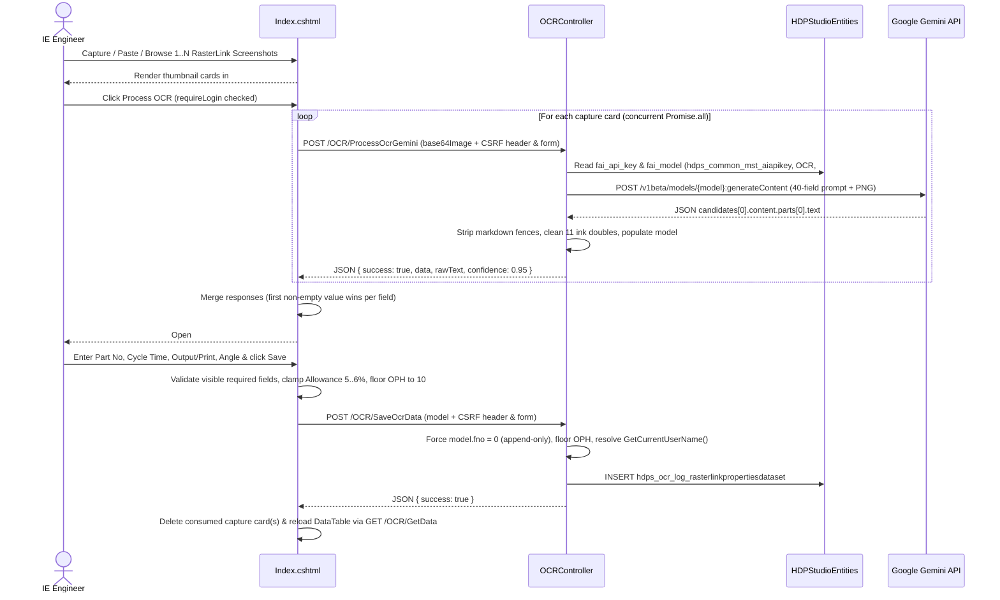
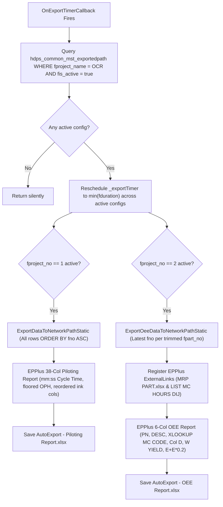
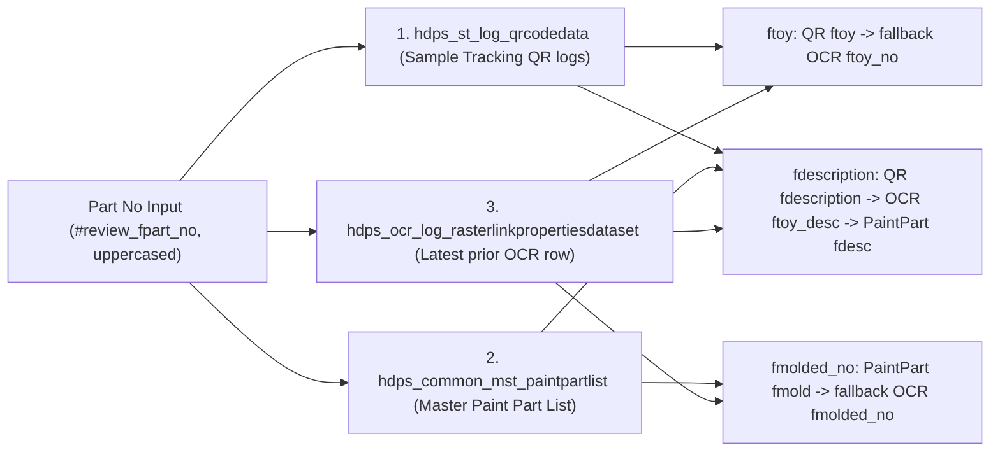

# HDP Piloting Report DIJ — System Architecture

**HDP Piloting Report DIJ** pairs a rich jQuery/DataTables client workspace (`Index.cshtml`, `Settings.cshtml`) with a dual-`DbContext` ASP.NET MVC 5 controller (`OCRController.cs`) that integrates an external **Google Gemini Vision REST API** for Mimaki RasterLink OCR and a background **EPPlus** dual-workbook exporter.

## 1. High-Level Component & Dual-DbContext Architecture

```mermaid
flowchart TB
    subgraph Client["Browser Client (_Layout_HDPStudio.cshtml + Views/OCR/)"]
        MainUI["Index.cshtml (4 Capture Modes, Review Modal, 39-Col DataTable, excelHtml5)"]
        SettingsUI["Settings.cshtml (3 Tabs: Piloting Export, OEE Export, Cycle Time Defaults)"]
        GearStrip["isOcrSidebar Right Strip (Settings Link)"]
    end

    subgraph Server["ASP.NET MVC 5 (Controllers/OCRController.cs)"]
        Views["GET Index & Settings"]
        Lookups["GET GetData, GetSettingsData & 12 Lookup Catalogs"]
        OcrAPI["POST ProcessOcrGemini (HttpClient + Dual CSRF)"]
        WriteAPI["POST SaveOcrData, Delete, SaveSettingsData (Dual CSRF)"]
        Timer["Static System.Threading.Timer (_exportTimer)"]
        Exporter["EPPlus Exporters (Piloting 38-Col & OEE 6-Col XLOOKUP)"]
    end

    subgraph External["External Cloud AI"]
        Gemini["Google Gemini Vision API (generativelanguage.googleapis.com)"]
    end

    subgraph DB1["EF6: HDPStudioEntities"]
        T_Log["hdps_ocr_log_rasterlinkpropertiesdataset (81 cols)"]
        T_AI["hdps_common_mst_aiapikey"]
        T_Exp["hdps_common_mst_exportedpath (OCR #1 & #2)"]
        T_Set["hdps_common_mst_setting (C05 Piloting #1..4)"]
        T_Ref["hdps_common_mst_machine, paintpartlist, st_log_qrcodedata"]
    end

    subgraph DB2["EF6: ProddevEntities2"]
        T_User["pd_user (Display Name Lookup)"]
    end

    subgraph Share["Shared Network File Server"]
        Xlsx1["AutoExport - Piloting Report.xlsx"]
        Xlsx2["AutoExport - OEE Report.xlsx"]
        ExtBooks["External XLOOKUP Sources (MRP PART.xlsx & LIST MC HOURS DIJ)"]
    end

    GearStrip --> SettingsUI
    MainUI --> Lookups
    MainUI --> OcrAPI
    MainUI --> WriteAPI
    SettingsUI --> Lookups
    SettingsUI --> WriteAPI

    OcrAPI --> T_AI
    OcrAPI -->|"POST generateContent (Base64 PNG)"| Gemini
    Lookups --> T_Log
    Lookups --> T_Exp
    Lookups --> T_Set
    Lookups --> T_Ref
    WriteAPI --> T_Log
    WriteAPI --> T_Exp
    WriteAPI --> T_Set
    WriteAPI --> T_User
    Views --> T_User

    Timer -->|"Poll min(fduration)"| T_Exp
    Timer --> Exporter
    Exporter --> T_Log
    Exporter --> Xlsx1
    Exporter --> Xlsx2
    ExtBooks -.->|"ExternalLinks XLOOKUP"| Xlsx2
```

### Architectural Layer Responsibilities

| Layer | Responsibility | Key Files / Symbols |
| :--- | :--- | :--- |
| **Shell & Settings Dock** | Renders `HDP Piloting Report DIJ` header, bypasses login for viewing, renders `isOcrSidebar` right-edge gear shortcut | `Views/Shared/_Layout_HDPStudio.cshtml` |
| **Capture, Review & Table UI** | Handles 4 screenshot capture flows, concurrent multi-card Gemini OCR merge, IE math calculators, DPU conditional validation, DataTable & client Excel export | `Views/OCR/Index.cshtml` |
| **Settings UI** | Configures Piloting & OEE export paths/intervals/active switches and 4 IE cycle-time parameters with per-tab default resets | `Views/OCR/Settings.cshtml` |
| **Controller & AI Bridge** | Calls Gemini Vision REST API using DB-stored API key/model, parses 40-field JSON, enforces dual CSRF, appends piloting revisions, resolves INSIDE display names | `Controllers/OCRController.cs`, `ValidateAntiForgeryTokenAjaxAttribute` |
| **Background Dual Exporter** | Polls active `OCR` export configs (`fproject_no = 1 & 2`) and regenerates 38-col Piloting `.xlsx` and 6-col `XLOOKUP` OEE `.xlsx` via EPPlus | `_exportTimer`, `OnExportTimerCallback`, `ExportDataToNetworkPathStatic`, `ExportOeeDataToNetworkPathStatic` |
| **Persistence** | Stores 81-column piloting records, AI key/model config, export paths, IE settings, reference catalogs (`HDPStudioEntities`), and user names (`ProddevEntities2`) | 7 `HDPStudioEntities` tables + `pd_user` |

## 2. Multi-Image Capture, Concurrent Gemini OCR & Append-Only Save Sequence

Mimaki RasterLink's Properties dialog often requires scrolling across multiple sections (General, Print Setup, Ink Consumption). Engineers can queue multiple screenshot cards and click **Process OCR** once — `Index.cshtml` dispatches all cards in parallel via `Promise.all` and merges fields with **first-non-empty precedence** before opening the Review Modal.

## 3. Dual Scheduled EPPlus Auto-Export Pipeline

A single static `System.Threading.Timer` (`_exportTimer`, initialized with a `10s` startup delay and `min(fduration)` period, fallback `300s`) drives two distinct `.xlsx` outputs from `hdps_ocr_log_rasterlinkpropertiesdataset`:

## 4. 3-Table Part Number Auto-Fill Cascade

Whenever an engineer types or selects a `Part No` in `#review_fpart_no`, `updateToyInfoByPartNo()` checks the preloaded `partNumberMap` and falls back to `GET /OCR/GetToyByPartNo`, resolving missing Toy/Mold metadata across three SQL tables in strict priority order:

## 5. Security, Hygiene & Operational Observations

The following architectural strengths and hardening opportunities were verified directly from `OCRController.cs`, `Index.cshtml`, and `Settings.cshtml`:

### Verified Strengths
- **Dual-Source CSRF Defense (CWE-352):** All four `[HttpPost]` endpoints (`SaveSettingsData`, `ProcessOcrGemini`, `SaveOcrData`, `Delete`) enforce both `[ValidateAntiForgeryToken]` and custom `[ValidateAntiForgeryTokenAjax]`, validating tokens sent via request headers or form body.
- **Parameterized Queries Only (CWE-89):** Every read and write across `HDPStudioEntities` and `ProddevEntities2` uses strongly typed EF6 LINQ queries with zero raw SQL concatenation.
- **No Hardcoded AI Secrets:** The Gemini API key and model name are read dynamically from `hdps_common_mst_aiapikey` rather than embedded in source code.
- **Consistent Floor-to-10 Enforcement:** `Output per Hour` (`Math.Floor(val / 10.0) * 10.0`) is enforced consistently on client calculation, `SaveOcrData`, DataTable rendering, and server-side EPPlus export.

### Operational & Hardening Considerations

> [!WARNING]
> **Missing Server-Side Session Authorization on `POST` Endpoints & `/OCR/Settings`:** Although `Index.cshtml` enforces `requireLogin()` in JavaScript for Add, OCR, Edit, and Delete, `OCRController`'s `SaveSettingsData`, `ProcessOcrGemini`, `SaveOcrData`, and `Delete` actions do **not** verify `Session["us_usrname"] != null` server-side. Additionally, `Views/OCR/Settings.cshtml` declares `bool isLoggedIn = Session["us_usrname"] != null;` on line 4 without using it, allowing unauthenticated visitors to view and modify export paths and cycle-time settings. Adding server-side session checks to all 4 `POST` actions (and gating `/OCR/Settings`) is recommended in a future `inside-mvc` hardening pass.

- **Missing `Dispose(bool)` Override:** `OCRController` instantiates both `HDPStudioEntities` and `ProddevEntities2` without overriding `Dispose(bool disposing)` to release database connections deterministically at request end.
- **Shared `_exportTimer` Minimum Interval:** `OnExportTimerCallback` sets one shared timer period to `durations.Min()` across active `OCR` configs (`fproject_no = 1` and `2`), and then runs **both** active exports on every tick. If Piloting Report is configured for `60s` and OEE Report for `600s`, both workbooks actually regenerate every `60s`.
- **IIS AppDomain Timer & External Workbook Caveats:** Like other static-timer exporters in `inside-mvc`, IIS idle app-pool recycle pauses scheduled exports until the next HTTP hit wakes `OCRController`, exceptions only write to `Debug.WriteLine`, and `ExportOeeDataToNetworkPathStatic` depends on IIS App Pool read access to external network files (`MRP PART.xlsx`, `LIST MC HOURS DIJ for OEE calc.xlsx`) when building `ExternalLinks`.
- **Append-Only Edit vs. Hard Delete:** `SaveOcrData` always forces `model.fno = 0` so edits create new revision rows rather than overwriting history; however, `Delete(int id)` performs a physical `Remove(item)` hard delete (ignoring soft-delete columns `fdeleted_at`/`fdeleted_by`).
- **Gemini API Key Query Parameter:** `ProcessOcrGemini` appends `?key={AIAPIKey}` in the outbound Gemini URL; migrating to the `x-goog-api-key` HTTP request header is a cleaner practice so keys never appear in proxy or server trace logs.
- **Hardcoded Dropdown Catalogs & Sculpt Reuse:** Dropdown endpoints (`GetMcCodes`, `GetDijNestTypes`, `GetCleaningProcesses`, `GetPackingTypes`, `GetStatusArrays`, `GetStatusSamples`, `GetDpuOptions`, `GetMaterialParts`, `GetPicPilotingOptions`) return hardcoded C# lists rather than master SQL tables, and `loadSculptNumbers()` in `Index.cshtml` calls `GetToyNumbers` as its suggestion source.

## Next Step

Explore the 4 screenshot capture flows, batch OCR cards, 4-mode review modal, DPU conditional form, DataTable client export, and 3-tab Settings UI in [UI, OCR Capture & Settings](./ui-ocr-and-settings.md).
