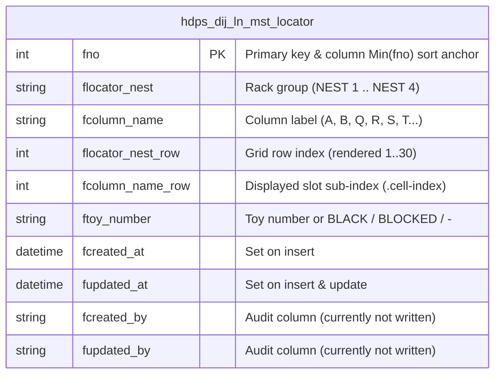

# HDP Locator Nest DIJ — API & Database Schema

All server endpoints for **HDP Locator Nest DIJ** live in `Controllers/LocatorNestDIJController.cs` (namespace `LoginAndRegisterMVCMD5.Controllers`), operating exclusively against `HDPStudioEntities.hdps_dij_ln_mst_locator`.

## 1. Endpoint Summary Matrix

| Method | Route | Auth / Session Check | CSRF Required | Content Type | Purpose |
| :---: | :--- | :---: | :---: | :--- | :--- |
| `GET` | `/LocatorNestDIJ` *(or `/Index`)* | Open *(shell bypass)* | No | `text/html` | Renders `Views/LocatorNestDIJ/Index.cshtml` |
| `GET` | `/LocatorNestDIJ/GetLocatorData` | Open | No | `application/json` | Returns all locator records grouped by Nest, Column, and Row |
| `POST` | `/LocatorNestDIJ/UpdateLocator` | **Required** (`Session["us_usrname"] != null`) | **Yes** (`[ValidateAntiForgeryToken]`) | `application/json` | Inserts or updates a single slot record in `hdps_dij_ln_mst_locator` |

## 2. Controller Endpoint Contracts

### `GET /LocatorNestDIJ/Index`

Returns `Views/LocatorNestDIJ/Index.cshtml` directly without preloading database records. The view checks `@(Session["us_usrname"] != null ? "true" : "false")` to initialize client-side `isLoggedIn`, then fetches rack data via `GetLocatorData` on `DOMContentLoaded`.

### `GET /LocatorNestDIJ/GetLocatorData`

Reads all rows from `dbHDPStudioEntities.hdps_dij_ln_mst_locator.ToList()` and transforms them into a 3-level hierarchy in memory:

1. **Level 1 — Nest Groups:** Grouped by `x.flocator_nest ?? "UNKNOWN NEST"`, ordered alphabetically (`OrderBy(g => g.Key)`).
2. **Level 2 — Columns within Nest:** Grouped by `x.fcolumn_name ?? ""`, ordered by the **minimum primary key** in each column (`OrderBy(cg => cg.Min(x => x.fno))`) so columns preserve their original database-creation sequence.
3. **Level 3 — Rows within Column:** Ordered ascending by `flocator_nest_row`.

**Example Response (`200 OK`):**

```json
[
  {
    "NestName": "NEST 1",
    "Columns": [
      {
        "ColumnName": "A",
        "Rows": [
          {
            "fno": 1,
            "flocator_nest_row": 1,
            "ftoy_number": "HDP-2041",
            "fcolumn_name_row": 1
          },
          {
            "fno": 2,
            "flocator_nest_row": 2,
            "ftoy_number": "",
            "fcolumn_name_row": 2
          },
          {
            "fno": 3,
            "flocator_nest_row": 3,
            "ftoy_number": "BLOCKED",
            "fcolumn_name_row": 3
          }
        ]
      }
    ]
  }
]
```

### `POST /LocatorNestDIJ/UpdateLocator`

Upserts a single cell record. Enforces `[HttpPost]`, `[ValidateAntiForgeryToken]`, and `if (Session["us_usrname"] == null)`.

**Form Parameters (`multipart/form-data` via `FormData`):**

| Field | CLR Type | Required | Description |
| :--- | :--- | :---: | :--- |
| `fno` | `int?` | Optional | Existing primary key (omitted by UI when `fno <= 0` for uncreated grid slots) |
| `nestName` | `string` | **Yes** | Rack identifier (`flocator_nest`, e.g., `"NEST 1"`) |
| `columnName` | `string` | **Yes** | Column label (`fcolumn_name`, e.g., `"A"`, `"Q"`) |
| `nestRow` | `int` | **Yes** | Vertical row index `1`–`30` (`flocator_nest_row`) |
| `toyNumber` | `string` | Optional | Trimmed Toy Number, empty string to clear, or `"BLACK"` / `"BLOCKED"` / `"-"` to block |
| `columnNameRow` | `int?` | Optional | Slot sub-index number (`fcolumn_name_row`); omitted if blank |
| `__RequestVerificationToken` | `string` | **Yes** | ASP.NET MVC anti-forgery token from `#edit-cell-form` |

**Record Resolution & Upsert Logic:**

1. **Auth Check:** If `Session["us_usrname"] == null`, immediately returns `{ "success": false, "message": "Unauthorized. Please login." }`.
2. **Lookup Precedence:**
   - If `fno.HasValue && fno.Value > 0`: queries `x => x.fno == fno.Value`.
   - Otherwise: queries by composite coordinate `x.flocator_nest == nestName && x.fcolumn_name == columnName && x.flocator_nest_row == nestRow`.
3. **Insert vs. Update:**
   - **Insert (not found):** Creates a new `hdps_dij_ln_mst_locator` with `flocator_nest`, `fcolumn_name`, `flocator_nest_row`, `ftoy_number`, `fcolumn_name_row`, `fcreated_at = DateTime.Now`, `fupdated_at = DateTime.Now`.
   - **Update (found):** Updates `ftoy_number`, `fcolumn_name_row`, and `fupdated_at = DateTime.Now` (`EntityState.Modified`).
4. Commits via `dbHDPStudioEntities.SaveChanges()`.

**Responses:**

```json
{ "success": true }
```

```json
{ "success": false, "message": "Unauthorized. Please login." }
```

## 3. Database Schema (`HDPStudioEntities`)

Source model: `Models/hdps_dij_ln_mst_locator.cs`. All module data resides in one master table without foreign-key dependencies on other tables.



### Column Definitions (`hdps_dij_ln_mst_locator`)

| Key | Column | CLR Type | Nullable | Role in Locator Nest DIJ |
| :---: | :--- | :--- | :---: | :--- |
| **PK** | `fno` | `int` | No | Auto-increment primary key; also determines column left-to-right display order via `Min(fno)` within each Nest |
| | `flocator_nest` | `string` | Yes | Rack card title and grouping key (e.g., `"NEST 1"`, `"NEST 2"`, `"NEST 3"`, `"NEST 4"`; null falls back to `"UNKNOWN NEST"`) |
| | `flocator_nest_row` | `int?` | Yes | Vertical slot position matched against `r = 1..30` in `Index.cshtml` |
| | `fcolumn_name` | `string` | Yes | Rack column header spanning 2 sub-cells (`colspan="2"`); columns `Q`–`T` in `NEST 3` trigger orange available tint |
| | `fcolumn_name_row` | `int?` | Yes | Small sub-index rendered in `.cell-index`; when non-null and `ftoy_number` is empty, marks the slot as available/zone-colored |
| | `ftoy_number` | `string` | Yes | Stored Toy Number rendered in `.cell-main`, searched live, or checked against blocked sentinels (`BLACK`, `BLOCKED`, `-`) |
| | `fcreated_at` | `DateTime?` | Yes | Set to `DateTime.Now` when `UpdateLocator` inserts a new row |
| | `fupdated_at` | `DateTime?` | Yes | Set to `DateTime.Now` on both insert and update in `UpdateLocator` |
| | `fcreated_by` | `string` | Yes | Standard audit column present in schema *(not currently populated by controller)* |
| | `fupdated_by` | `string` | Yes | Standard audit column present in schema *(not currently populated by controller)* |

## 4. Diagnostic SQL Queries

### Inspect Column Display Order per Nest

Because columns sort by `MIN(fno)`, run this query to verify the exact left-to-right column order rendered in the UI:

```sql
SELECT flocator_nest, fcolumn_name, MIN(fno) AS first_fno, COUNT(*) AS slot_count
FROM hdps_dij_ln_mst_locator
GROUP BY flocator_nest, fcolumn_name
ORDER BY flocator_nest, MIN(fno);
```

### Audit Rows Outside the 1–30 Display Range

Any rows returned by this query exist in SQL Server and JSON output but are hidden by the frontend `r = 1..30` loop:

```sql
SELECT fno, flocator_nest, fcolumn_name, flocator_nest_row, fcolumn_name_row, ftoy_number
FROM hdps_dij_ln_mst_locator
WHERE flocator_nest_row IS NULL
   OR flocator_nest_row < 1
   OR flocator_nest_row > 30;
```

### Check for Duplicate Slot Coordinates

If duplicate rows share `(flocator_nest, fcolumn_name, flocator_nest_row)`, the frontend `col.Rows.find(...)` only renders the first match:

```sql
SELECT flocator_nest, fcolumn_name, flocator_nest_row, COUNT(*) AS dup_count
FROM hdps_dij_ln_mst_locator
GROUP BY flocator_nest, fcolumn_name, flocator_nest_row
HAVING COUNT(*) > 1;
```
