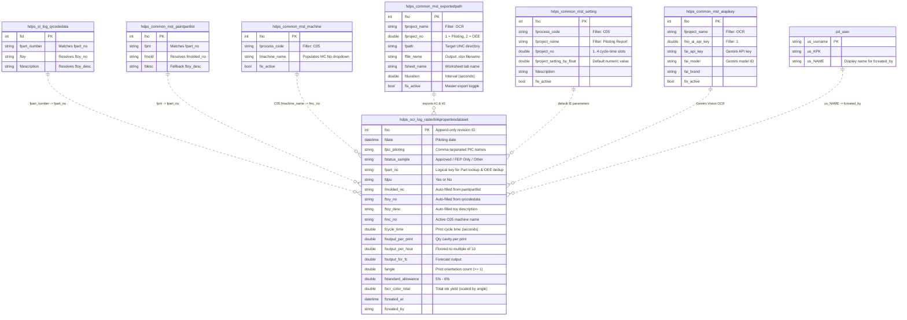

# HDP Piloting Report DIJ — Database Schema

**HDP Piloting Report DIJ** operates across two Entity Framework 6 Database-First contexts:
1. **`HDPStudioEntities`** — 7 tables covering the 81-column Piloting/RasterLink log, Gemini AI key config, dual export schedules, IE cycle-time defaults, active `C05` machines, and Part/Toy/Mold reference catalogs.
2. **`ProddevEntities2`** — `pd_user` table queried by `GetCurrentUserName()` to resolve an authenticated username/KPK into a display name.

## 1. Entity Relationship Diagram

Tables connect logically at the application layer via `fpart_no` / `fpnt` / `fpart_number`, `fprocess_code = "C05"`, `fproject_name`, and `us_usrname`.



## 2. Core Table: `hdps_ocr_log_rasterlinkpropertiesdataset` (81 Columns)

Source model: `Models/hdps_ocr_log_rasterlinkpropertiesdataset.cs`. Organized below into four functional column groups:

### Group A — Identity, Scoping & Audit (13 Columns)

| Column | CLR Type | Role |
| :--- | :--- | :--- |
| `fno` | `int` (PK) | Auto-increment primary key (always inserted as new row via `SaveOcrData`) |
| `fcreated_at`, `fcreated_by` | `DateTime?` / `string` | Creation timestamp and resolved display name (`GetCurrentUserName()`, fallback `"OCR System"`) |
| `fupdated_at`, `fupdated_by` | `DateTime?` / `string` | Set to `null` on insert (append-only model) |
| `fdeleted_at`, `frestored_at`, `fdeleted_by`, `frestored_by` | `DateTime?` / `string` | Standard HDP Studio audit columns *(not populated by `Delete`, which hard-deletes)* |
| `fprocess_code`, `fmachine_code`, `fmachine_name`, `fmachine_no` | `string` / `double?` | Standard HDP Studio scoping columns |

### Group B — Hidden RasterLink OCR Metadata & Timings (29 Columns)

Extracted by `ProcessOcrGemini` and persisted via hidden form inputs in `#ocrReviewForm`:

| Sub-Group | Columns (all `string`, nullable) |
| :--- | :--- |
| **Job & File (10)** | `focr_job_name`, `focr_file_name`, `focr_format`, `focr_image_size`, `focr_pages`, `focr_page_size`, `focr_favorite_spool_settings`, `focr_job_attribute`, `focr_use_special_color_names`, `focr_color_adjustment_set` |
| **Print Profile & Quality (11)** | `focr_media`, `focr_resolution`, `focr_input_profile_icc`, `focr_profile_name`, `focr_number_of_overprints`, `focr_pass`, `focr_fast_print`, `focr_print_direction`, `focr_special_color_over_print`, `focr_edge_optimizer`, `focr_ink_saving` |
| **Timings, Dates & Paths (8)** | `focr_time_spool`, `focr_time_rip`, `focr_time_print`, `focr_file_size_ripped_data`, `focr_date`, `focr_last_print_date`, `focr_last_cut_date`, `focr_working_directory` |

### Group C — RasterLink Ink Yield Channels (11 Columns, all `double?`)

`focr_color_cyan`, `focr_color_magenta`, `focr_color_yellow`, `focr_color_black`, `focr_color_light_cyan`, `focr_color_light_magenta`, `focr_color_white`, `focr_color_white2`, `focr_color_white3`, `focr_color_clear`, `focr_color_total`. Stored multiplied by `fangle` (rounded to 3 decimal places) and nulled when `DPU = Yes`.

### Group D — Piloting, Nest, Cycle Time, Output & Packing (28 Columns)

| Column | CLR Type | Role |
| :--- | :--- | :--- |
| `fpic_piloting` | `string` | Comma-separated IE engineer names |
| `fdate` | `DateTime?` | Piloting date (defaults to `fcreated_at` if omitted) |
| `fstatus_sample` | `string` | Sample status (`Approved`, `FEP Only`, `Other`) |
| `fpart_no` | `string` | Uppercase Part Number (lookup key & OEE deduplication key) |
| `fdpu` | `string` | `"Yes"` or `"No"` (controls conditional form clearing) |
| `fsculpt_no`, `fmolded_no`, `ftoy_no`, `ftoy_desc`, `fmaterial_part` | `string` | Product & tooling identifiers |
| `fmc_no`, `fmc_code`, `fdij_nest_type`, `fnest_identification` | `string` | DIJ machine & nest fixture configuration |
| `fcycle_time`, `fload_unload_nest`, `fadditional_auto_cleaning`, `fadditional_auto_wiping` | `double?` | Time components stored in **seconds** (displayed as `mm:ss`) |
| `fstandard_allowance` | `double?` | Allowance percentage (`5.0` – `6.0`) |
| `fangle` | `double?` | Number of print angles (`>= 1`, default `1`) |
| `foutput_per_print`, `foutput_per_hour`, `foutput_for_fc` | `double?` | Cavity output, floored hourly output (multiple of `10`), and forecast output |
| `fcleaning_process`, `fpacking_type`, `fpacking_information`, `fstatus_array`, `ffc` | `string` / `double?` | Downstream cleaning, packing, array status, and forecast metadata (`ffc` column unused in form) |

## 3. Supporting Master & Reference Tables

| Table (`DbContext`) | Filter / Key Used by `OCRController` | Key Columns Read / Written |
| :--- | :--- | :--- |
| `hdps_common_mst_aiapikey` (`HDPStudioEntities`) | `fproject_name == "OCR" && fno_ai_api_key == 1`, latest `fno` | `fai_api_key`, `fai_model` *(read-only by controller)* |
| `hdps_common_mst_exportedpath` (`HDPStudioEntities`) | `fproject_name == "OCR"`, `fproject_no == 1` (Piloting) & `2` (OEE) | `fpath`, `ffile_name`, `fsheet_name`, `fduration`, `fdescription`, `fis_active`, `fupdated_at/by` |
| `hdps_common_mst_setting` (`HDPStudioEntities`) | `fprocess_code == "C05" && fproject_name == "Piloting Report"`, `fproject_no = 1..4` | `fproject_setting_by_float` (`1`: Load/unload, `2`: Auto cleaning, `3`: Auto wiping, `4`: Standard allowance `5–6%`) |
| `hdps_common_mst_machine` (`HDPStudioEntities`) | `fprocess_code == "C05" && fis_active == true` | `fmachine_name` (populates `MC No` autocomplete) |
| `hdps_common_mst_paintpartlist` (`HDPStudioEntities`) | `fpnt` (Part No) | `fpnt`, `fmold` (`fmolded_no`), `fdesc` (fallback description) |
| `hdps_st_log_qrcodedata` (`HDPStudioEntities`) | `fpart_number` (Sample Tracking QR log) | `fpart_number`, `ftoy`, `fdescription` |
| `pd_user` (`ProddevEntities2`) | `us_usrname == username \|\| us_KPK == username` | `us_NAME` (display name for `GetCurrentUserName()`) |

## 4. Diagnostic SQL Queries

### Verify Active Gemini OCR Configuration *(Without Printing Full Key)*

```sql
SELECT TOP 5 fno, fproject_name, fno_ai_api_key, fai_brand, fai_model,
       CASE WHEN LEN(LTRIM(RTRIM(ISNULL(fai_api_key, '')))) > 0 THEN 'Configured' ELSE 'Missing' END AS key_status,
       fis_active
FROM hdps_common_mst_aiapikey
WHERE fproject_name = 'OCR' AND fno_ai_api_key = 1
ORDER BY fno DESC;
```

### Verify Dual Auto-Export & Cycle-Time Settings

```sql
SELECT fproject_no, fproject_name, fpath, ffile_name, fsheet_name, fduration, fis_active
FROM hdps_common_mst_exportedpath
WHERE fproject_name = 'OCR'
ORDER BY fproject_no;

SELECT fproject_no, fdescription, fproject_setting_by_float
FROM hdps_common_mst_setting
WHERE fprocess_code = 'C05' AND fproject_name = 'Piloting Report'
ORDER BY fproject_no;
```
